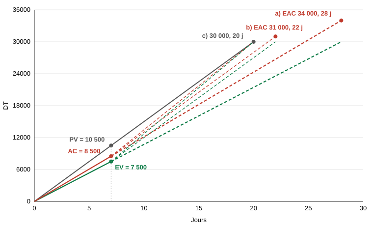

# Cas de projet : corrigé complet

> Ce corrigé a été calculé à partir des énoncés, sans le corrigé de l'enseignant. Les hypothèses sont signalées. Essayez d'abord de refaire chaque partie sans regarder.

**Projet : développement d'un site web.**

| Lot | Activité | Description | D (j) | Prédécesseur | Ressources |
|---|---|---|---|---|---|
| 1 | A | Élaboration du PMP | 3 | - | R1, R2 |
| 1 | B | Définition de la conception | 4 | A | R1, R3 |
| 2 | C | Étude de la conception | 2 | B | R2, R3 |
| 2 | D | Achat d'un PC | 1 | B | R9 |
| 2 | E | Installation du matériel | 1 | D | R9 |
| 3 | F | Réunion de suivi | 1 | C | R1, R2 |
| 3 | G | Développement | 2 | F | R4 |
| 3 | H | Préparation de l'intégration | 4 | F | R6, R7, R10 |
| 4 | I | Programmation | 5 | G | R5, R10 |
| 4 | J | Vérification des moyens | 1 | G, H | R1, R10 |
| 5 | K | Essais des moyens | 2 | J | R2, R9, R10 |
| 5 | L | Intégration et déploiement | 3 | I | R1, R6, R8 |

---

# Partie 1 : Planification des délais

## Q1. Niveaux

| Niveau | 1 | 2 | 3 | 4 | 5 | 6 | 7 |
|---|---|---|---|---|---|---|---|
| **Activités** | A | B | C, D | E, F | G, H | I, J | K, L |

## Q2. Réseau et données

```
Début ─► A ─► B ─┬─► D ─► E ─────────────────────► Fin
                 │
                 └─► C ─► F ─┬─► G ─┬─► I ─► L ──► Fin
                             │      │
                             │      └─► J ─► K ──► Fin
                             │          ▲
                             └─► H ─────┘
```

Liens : A→B ; B→C, B→D ; D→E ; C→F ; F→G, F→H ; G→I, G→J ; H→J ; I→L ; J→K.

| Activité | D | ES | EF | LS | LF | TF | FF | Critique |
|---|---|---|---|---|---|---|---|---|
| **A** | 3 | 0 | 3 | 0 | 3 | 0 | 0 | Oui |
| **B** | 4 | 3 | 7 | 3 | 7 | 0 | 0 | Oui |
| **C** | 2 | 7 | 9 | 7 | 9 | 0 | 0 | Oui |
| D | 1 | 7 | 8 | 18 | 19 | 11 | 0 | |
| E | 1 | 8 | 9 | 19 | 20 | 11 | 11 | |
| **F** | 1 | 9 | 10 | 9 | 10 | 0 | 0 | Oui |
| **G** | 2 | 10 | 12 | 10 | 12 | 0 | 0 | Oui |
| H | 4 | 10 | 14 | 13 | 17 | 3 | 0 | |
| **I** | 5 | 12 | 17 | 12 | 17 | 0 | 0 | Oui |
| J | 1 | 14 | 15 | 17 | 18 | 3 | 0 | |
| K | 2 | 15 | 17 | 18 | 20 | 3 | 3 | |
| **L** | 3 | 17 | 20 | 17 | 20 | 0 | 0 | Oui |

**Calculs clés :**
- `ES(J) = Max{EF(G) = 12 ; EF(H) = 14} = 14`
- `LF(G) = Min{LS(I) = 12 ; LS(J) = 17} = 12`
- `LF(B) = Min{LS(C) = 7 ; LS(D) = 18} = 7`
- `LF(F) = Min{LS(G) = 10 ; LS(H) = 13} = 10`
- `FF(G) = Min{ES(I) = 12 ; ES(J) = 14} − EF(G) = 12 − 12 = 0`

## Q3. Durée du projet

**20 jours.**

## Q4. Chemin critique

Il y a **un seul** chemin critique : **A → B → C → F → G → I → L** (3 + 4 + 2 + 1 + 2 + 5 + 3 = 20).

| Tous les chemins | Durée |
|---|---|
| **A-B-C-F-G-I-L** | **20** |
| A-B-C-F-H-J-K | 17 |
| A-B-C-F-G-J-K | 15 |
| A-B-D-E | 9 |

## Q5. Gantt

`██` critique, `==` non critique, `..` marge totale.

```
Jour  1 2 3 4 5 6 7 8 9 10  12  14  16  18  20
A    |██████
B    |      ████████
C    |              ████
D    |              ==......................
E    |                ==......................
F    |                  ██
G    |                    ████
H    |                    ========......
I    |                        ██████████
J    |                            ==......
K    |                              ====......
L    |                                  ██████
```

---

# Partie 2 : Ressources, coûts et trésorerie

## Q1. Besoin en ressources

| Ressource | Taux/j (DT) | Activités | Quantité (j) | Coût (DT) |
|---|---|---|---|---|
| R1 Chef projet | 800 | A, B, F, J, L | 12 | 9 600 |
| R2 Chef d'équipe | 700 | A, C, F, K | 8 | 5 600 |
| R3 Designer | 700 | B, C | 6 | 4 200 |
| R4 Développeur | 650 | G | 2 | 1 300 |
| R5 Programmeur | 600 | I | 5 | 3 000 |
| R6 Intégrateur | 500 | H, L | 7 | 3 500 |
| R7 Aide développeur | 300 | H | 4 | 1 200 |
| R8 Aide programmeur | 200 | L | 3 | 600 |
| R9 Logistique | 100 | D, E, K | 4 | 400 |
| R10 Aide | 50 | H, I, J, K | 12 | 600 |
| **Total** | | | **63** | **30 000** |

## Q2. BAC

| Lot | Activité | Coût/j | × Durée | Coût (DT) | **BAC du lot** |
|---|---|---|---|---|---|
| 1 | A | 800 + 700 = 1 500 | × 3 | 4 500 | |
| 1 | B | 800 + 700 = 1 500 | × 4 | 6 000 | **10 500** |
| 2 | C | 700 + 700 = 1 400 | × 2 | 2 800 | |
| 2 | D | 100 | × 1 | 100 | |
| 2 | E | 100 | × 1 | 100 | **3 000** |
| 3 | F | 800 + 700 = 1 500 | × 1 | 1 500 | |
| 3 | G | 650 | × 2 | 1 300 | |
| 3 | H | 500 + 300 + 50 = 850 | × 4 | 3 400 | **6 200** |
| 4 | I | 600 + 50 = 650 | × 5 | 3 250 | |
| 4 | J | 800 + 50 = 850 | × 1 | 850 | **4 100** |
| 5 | K | 700 + 100 + 50 = 850 | × 2 | 1 700 | |
| 5 | L | 800 + 500 + 200 = 1 500 | × 3 | 4 500 | **6 200** |
| | | | | **BAC du projet** | **30 000 DT** |

**Remarque utile :** selon les dates au plus tôt, le coût est **exactement 1 500 DT chaque jour**. C'est la « régularité des coûts journaliers » citée en partie 3.

## Q3. Tableau de trésorerie

**Hypothèses de ce corrigé :**
- la période fait 4 jours et les activités sont placées au plus tôt ;
- chaque lot est **facturé dans la période où il se termine**, à `coût × 1,30` ;
- il est encaissé **2 périodes plus tard** ;
- les soldes sont lus en fin de période.

| Lot | Fin (jour) | Période de fin | Encaissé en | Recette = coût × 1,3 |
|---|---|---|---|---|
| 1 | 7 | P2 | **P4** | 13 650 |
| 2 | 9 | P3 | **P5** | 3 900 |
| 3 | 14 | P4 | **P6** | 8 060 |
| 4 | 17 | P5 | **P7** | 5 330 |
| 5 | 20 | P5 | **P7** | 8 060 |
| | | | **Total** | **39 000** |

| Période (jours) | P1 (1-4) | P2 (5-8) | P3 (9-12) | P4 (13-16) | P5 (17-20) | P6 | P7 |
|---|---|---|---|---|---|---|---|
| Dépenses | 6 000 | 6 000 | 6 000 | 6 000 | 6 000 | 0 | 0 |
| Recettes | 0 | 0 | 0 | 13 650 | 3 900 | 8 060 | 13 390 |
| Flux net | −6 000 | −6 000 | −6 000 | +7 650 | −2 100 | +8 060 | +13 390 |
| **Cumul** | −6 000 | −12 000 | **−18 000** | −10 350 | −12 450 | −4 390 | **+9 000** |

**Contrôle :** bénéfice = 30 % × 30 000 = **9 000 DT**, égal au cumul final.

## Q4. Besoin de financement

Le cumul le plus bas est atteint en P3 : **18 000 DT**.

## Q5. Financement externe

`18 000 − 7 000 =` **11 000 DT**.

## Q6. Plan de financement

**Hypothèse :** on utilise d'abord les fonds propres, et on rembourse d'abord le financement externe. Les intérêts ne sont pas donnés, donc ils sont ignorés.

| Période | Flux net | Fonds propres | Externe | Encours propre | Encours externe |
|---|---|---|---|---|---|
| P1 | −6 000 | Apport 6 000 | | 6 000 | 0 |
| P2 | −6 000 | Apport 1 000 | Emprunt 5 000 | 7 000 | 5 000 |
| P3 | −6 000 | | Emprunt 6 000 | 7 000 | **11 000** |
| P4 | +7 650 | | Remboursement 7 650 | 7 000 | 3 350 |
| P5 | −2 100 | | Emprunt 2 100 | 7 000 | 5 450 |
| P6 | +8 060 | Récupère 2 610 | Remboursement 5 450 | 4 390 | 0 |
| P7 | +13 390 | Récupère 4 390 | | 0 | 0 |

Après remboursement, il reste **9 000 DT de bénéfice** en P7.

> Variante acceptable : en P4, garder 2 100 DT en caisse au lieu de rembourser puis réemprunter. Le remboursement de P4 passe à 5 550 DT, et l'encours externe de P4 et P5 reste à 5 450 DT.

> **Si l'enseignant facture autrement :** le résultat change. Par exemple, si chaque période était facturée au fil de l'eau (6 000 × 1,3 = 7 800 encaissés 2 périodes plus tard), le besoin ne serait que de **12 000 DT** (externe : 5 000 DT). Le fichier Excel du cours n'étant pas fourni, cette convention reste à confirmer.

---

# Partie 3 : Suivi et maîtrise (rapport au jour 7)

**Données :** avancement 25 %, coût réel 8 500 DT, BAC = 30 000 DT, SAC = 20 j, PAR = 30 000 / 20 = **1 500 DT/j**.

## Q1. Valeurs de base

- `EV = 25 % × 30 000 =` **7 500 DT**
- `PV = 7 × 1 500 =` **10 500 DT** (= lot 1, soit A + B, prévu fini au jour 7)
- `AC =` **8 500 DT**

## Q2. Analyse

| Indicateur | Calcul | Résultat | Interprétation |
|---|---|---|---|
| SV | 7 500 − 10 500 | **−3 000 DT** | Retard, soit −3 000 / 1 500 = **−2 jours** |
| CV | 7 500 − 8 500 | **−1 000 DT** | **Dépassement** de budget |
| SPI | 7 500 / 10 500 | **0,714** | Avancement à 71,4 % du plan |
| CPI | 7 500 / 8 500 | **0,882** | Chaque dinar dépensé ne produit que 0,882 DT de valeur |

**Conclusion :** le projet est **en retard et en dépassement de budget**.

## Q3. Les trois scénarios

### a) La tendance du jour 7 continue

- **Coût :** `ETC = (30 000 − 7 500) / 0,882 = 22 500 / 0,882353 = 25 500 DT`
- `EAC = 8 500 + 25 500 =` **34 000 DT**
- `VAC = 30 000 − 34 000 =` **−4 000 DT**
- **Délai :** vitesse = 25 % / 7 j. Il reste 75 %, soit 75 / (25 / 7) = **21 j**.
- Délai total = 7 + 21 = **28 jours** (= 20 / 0,714). Écart = 20 − 28 = **−8 jours**.

### b) Action corrective, retour à l'estimation initiale

- **Coût :** `ETC = 30 000 − 7 500 = 22 500 DT`
- `EAC = 8 500 + 22 500 =` **31 000 DT**
- `VAC =` **−1 000 DT** (le CV du jour 7)
- **Délai :** 75 % × 20 j = 15 j. Délai total = **22 jours**. Écart = **−2 jours** (le retard du jour 7).

### c) Finir conformément au plan initial (30 000 DT, 20 jours)

- **Temps restant :** 20 − 7 = 13 j. **Budget restant :** 30 000 − 8 500 = 21 500 DT.
- **Avancement à réaliser :** 75 % / 13 = **5,77 % par jour** (contre 5 % planifiés).
- **Coût à dépenser :** 21 500 / 13 = **1 653,85 DT par jour** (contre 1 500 DT planifiés).
- **Coût pour 1 % d'avancement :** 21 500 / 75 = 286,67 DT (contre 300 DT planifiés) : il faut donc aller plus vite **et** coûter moins cher par unité de travail.
- `EAC = 30 000 DT`, `VAC = 0`, écart de délai = 0.

### Récapitulatif

| Scénario | ETC | EAC | VAC | Délai total | Écart de délai |
|---|---|---|---|---|---|
| a) Tendance | 25 500 | **34 000** | **−4 000** | 28 j | **−8 j** |
| b) Plan initial | 22 500 | **31 000** | **−1 000** | 22 j | **−2 j** |
| c) Finir comme prévu | 21 500 | **30 000** | **0** | 20 j | **0** |

### Lecture graphique



| Courbe | Point de départ | Point d'arrivée |
|---|---|---|
| PV | (0 ; 0) | (20 ; 30 000) |
| EV jusqu'au jour 7 | (0 ; 0) | (7 ; 7 500) |
| AC jusqu'au jour 7 | (0 ; 0) | (7 ; 8 500) |
| a) AC prolongée | (7 ; 8 500) | (28 ; 34 000) |
| a) EV prolongée | (7 ; 7 500) | (28 ; 30 000) |
| b) AC prolongée | (7 ; 8 500) | (22 ; 31 000) |
| b) EV prolongée | (7 ; 7 500) | (22 ; 30 000) |
| c) AC prolongée | (7 ; 8 500) | (20 ; 30 000) |
| c) EV prolongée | (7 ; 7 500) | (20 ; 30 000) |

---

# Variante « P1 2526 » (partie 3)

**Probablement un sujet de l'année 2025-2026**, d'après son titre. Il utilise une « feuille de réponse » et il est à connaître.

**Données :** BAC = 29 000 DT, SAC = 5 mois, rapport à la **12e semaine (fin du 3e mois, à 4 semaines par mois)**, avancement 65 %, coût réel 21 000 DT. PAR = 29 000 / 5 = **5 800 DT/mois**.

## Q1 et Q2

| Indicateur | Calcul | Résultat | Interprétation |
|---|---|---|---|
| EV | 65 % × 29 000 | **18 850 DT** | |
| PV | 3 × 5 800 | **17 400 DT** | |
| AC | | **21 000 DT** | |
| SV | 18 850 − 17 400 | **+1 450 DT** | **En avance** de 0,25 mois (1 semaine) |
| CV | 18 850 − 21 000 | **−2 150 DT** | **Dépassement** de budget |
| SPI | 18 850 / 17 400 | **1,083** | Avancement à 108 % du plan |
| CPI | 18 850 / 21 000 | **0,898** | 0,898 DT de valeur pour 1 DT dépensé |

**Conclusion :** en avance sur le délai, mais au-dessus du budget. Il faut regarder les deux indicateurs, car on peut gagner du temps en dépensant trop.

## Q3

| Scénario | ETC | EAC | VAC | Délai total | Écart de délai |
|---|---|---|---|---|---|
| a) Tendance | 10 150 / 0,8976 = **11 307,69** | **32 307,69** | **−3 307,69** | 3 + 35 / (65 / 3) = 3 + 1,615 = **4,615 mois** | **+0,385 mois** |
| b) Plan initial | **10 150** | **31 150** | **−2 150** | 3 + 35 % × 5 = **4,75 mois** | **+0,25 mois** |

**c) Finir au plan initial :** il reste 2 mois, 35 % à réaliser et 29 000 − 21 000 = 8 000 DT.
- Avancement : 35 % / 2 = **17,5 % par mois** (contre 20 % planifiés).
- Coût : 8 000 / 2 = **4 000 DT par mois** (contre 5 800 DT planifiés).
